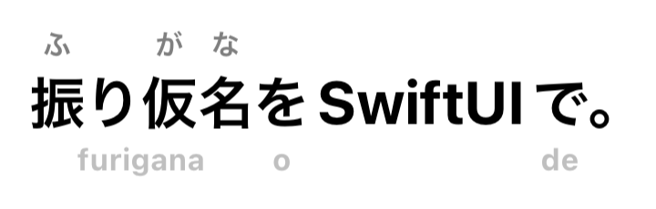

# RubyText

Furigana and romaji for SwiftUI.



RubyText shows Japanese text with readings above its kanji, romaji above or
below, or both, and finds the readings on device. Use it like `Text`:

```swift
RubyText("{今日|きょう}は日本語を勉強しています。")
    .font(.title)
    .rubyStyle([.furigana, .romaji])
```

- **Readings found on device:** MeCab with IPAdic or UniDic, rules for
  numbers, dates, counters and set phrases, and optionally a language model
  for words whose reading depends on their meaning: Apple's on-device
  model, or any provider's. `{base|reading}` markup overrides any of them.
  Long text is analyzed in the background, so it never holds up the
  interface.
- **Every way to write a reading:** furigana in hiragana, katakana or romaji;
  romaji above or below; inline readings, 東京（とうきょう）; or the whole text
  in hiragana, katakana or romaji. Romaji in Hepburn, Kunrei-shiki,
  Nihon-shiki, passport style, as typed, or for Turkish readers; readings in
  Cyrillic or Hangul; or in a style of your own.
- **For learners:** furigana only above a JLPT level, word colors by part of
  speech, JLPT level or your own vocabulary, space between words or phrases,
  and word details with definitions from JMdict.
- **Read aloud:** synthesized or from a recording, with the phrase being
  spoken emphasized.
- **Accessible:** VoiceOver says readings the way the furigana show them,
  and opens word details. Dynamic Type and Reduce Motion are respected, and
  copying gives the text without its readings.
- **Localized:** word details, parts of speech and VoiceOver hints are in
  English, Japanese, Chinese (Simplified and Traditional), Korean, Spanish,
  French, German, Italian, Portuguese, Russian, Turkish, Arabic, Hindi,
  Indonesian, Vietnamese and Thai.

To try it first, run [RubyText Demo](<RubyText Demo repository URL>). Its Try
tab shows your own text with any settings and gives you the code for them;
Features shows each feature with its code. If you code with an AI agent,
install [RubyText's skill](#with-an-ai-coding-agent) so it knows the API.

## Requirements

iOS 27, macOS 27 or visionOS 27, and Swift 6.2.

## Installation

Add RubyText with Swift Package Manager, in Xcode with File › Add Package
Dependencies, or in `Package.swift`:

```swift
.package(url: "https://github.com/yasinErdemli/RubyText", from: "1.8.0")
```

It has four products; take the ones you need:

| Product | What it does | Needs |
| --- | --- | --- |
| `RubyUI` | `RubyText` and the views around it | `RubyCore` |
| `RubyCore` | Readings as data: markup, rules, conversion, dictionary lookups, with the analyzer you choose | `RubyTransliteration` |
| `RubyMeCab` | An analyzer: MeCab with a dictionary in IPAdic's or UniDic's format | `RubyCore`, [Mecab-Swift](https://github.com/shinjukunian/Mecab-Swift), the `MeCab` trait |
| `RubyTransliteration` | Kana to romaji, hiragana and katakana | Only the standard library |

**MeCab is a package trait, on by default.** Mecab-Swift comes with its
dictionaries, about 400 MB in every build folder, and Swift Package Manager
downloads it whenever RubyText lists it, even for apps that never use
RubyMeCab. An app that doesn't use it can leave it out, from 1.1.0:

```swift
.package(url: "https://github.com/yasinErdemli/RubyText", from: "1.8.0", traits: [])
```

Then `RubyUI`, `RubyCore` and `RubyTransliteration` work as usual, with
another analyzer or with readings your app gives in markup or segments, and
`RubyMeCab` is an empty module.

### Analyzers and dictionaries

RubyText bundles no dictionary, and finds words and readings with whichever
analyzer your app chooses.

**MeCab**, from the `RubyMeCab` product, is the most complete, with
either of its two main dictionaries. The simplest way to get IPAdic is the
`IPADic` product of Mecab-Swift, which RubyMeCab depends on. Set the
analyzer once, near the root of your app:

```swift
import IPADic
import RubyMeCab
import RubyUI   // also imports RubyCore and RubyTransliteration

let analyzer = RubyMeCabAnalyzer(dictionary: IPADic().url)

ContentView()
    .rubyAnalyzer(analyzer)
```

**UniDic**, MeCab's other main dictionary, is maintained by the National
Institute for Japanese Language and Linguistics and knows more recent
words. Of 50 that became common after IPAdic was last updated in 2007,
such as 令和, 終活 and 自撮り, IPAdic reads 36 right, UniDic 2.1.2 39, and
UniDic 3.1 42. It's larger, though: 250 MB and 770 MB, against IPAdic's
50 MB. Pass a compiled UniDic folder, such as the `dicdir` folder of the
`unidic-lite` or `unidic` Python packages, to the same initializer, which
tells the two apart:

```swift
let analyzer = RubyMeCabAnalyzer(dictionary: unidicURL) // analyzer.format == .unidic
```

**Any other analyzer** works too: conform to `RubyAnalyzer`, which has one
method that splits text into words with readings. RubyText's rules for
numbers, counters and phrases, and readings by meaning, work on top of it.
The documentation's "Using Any Analyzer" article lists what each part of a
word gives, with an analyzer on Apple's built-in tokenizer: it needs no
dictionary, and reads 243 of the benchmark's 255 words right, as MeCab
reads 241 with IPAdic, 243 with UniDic 2.1.2 and 242 with UniDic 3.1. The
rules settle most of the benchmark whatever the analyzer; the words left
are those whose reading depends on meaning.

Short text is analyzed as it appears. Longer text, over 200 UTF-16 code
units, shows at once and is analyzed in the background, its readings
fading in, so a long passage never holds up the interface.

Without an analyzer, only readings in `{base|reading}` markup show.

**JMdict** gives word details their definitions. Build an SQLite database
from it with [`Tools/build-dictionary.py`](Tools/build-dictionary.py),
bundle it, and set it like the analyzer:

```swift
ContentView()
    .rubyDictionary(RubyDictionary(url: Bundle.main.url(forResource: "jmdict", withExtension: "sqlite")!))
```

JMdict's licence asks your app to acknowledge it, for example in an About
screen; see [NOTICES.md](NOTICES.md).

### With an AI coding agent

RubyText comes with a skill, in [`skills/rubytext`](skills/rubytext/SKILL.md),
that teaches AI coding agents to use it: setting up an analyzer, where markup
is read, every modifier with its options, readings by meaning with any
model, and the mistakes to avoid, such as forgetting the analyzer. An agent
loads it when you work on Japanese text, so it writes code for this API
rather than guessing.

In Claude Code, add this repository as a plugin marketplace and install the
skill:

```bash
claude plugin marketplace add yasinErdemli/RubyText
claude plugin install rubytext@rubytext
```

For Codex, Cursor, GitHub Copilot, Gemini CLI and other agents, the
[skills](https://github.com/vercel-labs/skills) command installs it:

```bash
npx skills add yasinErdemli/RubyText
```

Or copy the `skills/rubytext` folder into your project's `.claude/skills`
folder, or wherever your agent reads skills from. An agent that doesn't
support skills can still be told to read `skills/rubytext/SKILL.md`.

## Usage

### Styles

Annotations are set through the environment, like fonts, on a `RubyText` or
any view above it. Changes animate.

```swift
RubyText("東京へ行きたい。")
    .rubyStyle([.furigana, .romaji])        // furigana above, romaji below
    .rubyFuriganaScript(.katakana)          // トウキョウ over 東京
    .rubyRomanization(.nippon)              // Tôkyô
    .rubyFurigana(.above(.n4))              // none over N5 and N4 kanji
    .foregroundStyle(.primary, .red, .blue) // red furigana, blue romaji
```

`.rubyStyle(.romaji)` alone puts romaji above the text, and
`.rubyFuriganaPosition(.inline)` writes readings in parentheses:
東京（とうきょう）.

For learners still learning kana, `.kanaRomaji` puts romaji under each kana,
a beat at a time, with furigana above, and `rubyKanaRomaji(_:)` leaves out
the kana they can already read. Furigana are kana too, so a kanji gets the
romaji of its reading while its furigana show (oo under 大). They fade a kana
at a time as the learner learns them:

```swift
RubyText(segments: sentence)
    .rubyStyle([.furigana, .kanaRomaji])   // wa ta shi wa under わたしは
    .rubyKanaRomaji(.except(learnedKana))  // none under か once か is learned
```

SwiftUI's own text modifiers apply as they do to `Text`: `.font`,
`.multilineTextAlignment`, `.lineLimit` and `.truncationMode`, with readings
only over the text shown, and `.textSelection`. Unlike `Text`, it takes the
height of all its lines even where it's offered less; `.lineLimit` is what
cuts it short.

### Writing the text out

```swift
RubyText("今日はコーヒーを飲んだ。")
    .rubyTranscription(.hiragana) // きょうはコーヒーをのんだ。
```

`.hiragana(loanwords: .hiragana)` writes loanwords in hiragana too,
`.katakana` everything in katakana, and `.romaji` with
`.rubyRomanization(.passport)` gives kyo wa kohi o nonda.

`rubyRomanization(_:)` chooses how romaji are written: `.hepburn` by
default, `.kunrei`, `.nippon`, `.passport`, `.wapuro` (as typed: toukyou),
`.turkish` (Şinbun), `.polivanov` (Cyrillic: симбун) or `.hangul` (신분).
Names of people and places start with a capital: Tōkyō. For your own style,
change a built-in table, or conform to `RubyTransliterationStyle` for a
system a table can't express:

```swift
var style = RubyTableStyle.hepburn
style.words["東京"] = "Tokyo"
style.longVowels = .marked(RubyTableStyle.circumflexes)

RubyText(text)
    .rubyStyle(.romaji)
    .rubyRomanization(RubyRomanization(style))
```

For plain strings, such as for search or sharing, use `RubyConverter`:

```swift
let converter = RubyConverter(analyzer: analyzer)
converter.convert("感じ取れたら手を繋ごう", to: .romaji)      // kanjitoretara te o tsunagō
converter.annotate("東京へ行きたい。", with: .hiragana)    // 東京（とうきょう）へ行（い）きたい。
```

### Your own readings

Markup sets a reading where the automatic one is wrong, or for names:

```swift
RubyText("{宇宙|そら}を見上げた。")
RubyText(markup: json)   // markup you load at run time
RubyText(comment)        // a String: shown as written
```

Markup is read the way `Text` reads Markdown: in literals, and where you ask
for it with `RubyText(markup:)`. A `String` you pass, such as a comment
someone typed, is shown as written, so it can't add readings.

In code, give readings with string interpolation:

```swift
RubyText("\("今日", reading: "きょう")は\(user.name)さんと話した。")
RubyText("\(unannotated: "無印良品")で本を\(count)冊買った。") // 無印良品 is never annotated
```

`\(base, reading:)` takes an optional reading, so a missing one falls back to
analysis. Strings and numbers you interpolate are read with the words around
them, so `\(3)冊` reads さんさつ, and markup in them shows as written, so text
people type can't add readings. `PersonNameComponents` read with their
phonetic names, and your own types can too by conforming to
`RubyStringConvertible`:

```swift
struct User: RubyStringConvertible {
    var familyName = "田中", givenName = "花子"
    var familyKana: String? = "たなか", givenKana: String? = "はなこ"

    var rubyString: RubyString {
        "\(familyName, reading: familyKana)\(givenName, reading: givenKana)"
    }
}
```

Unlike `Text`, a literal isn't localized. For localized text, pass a
`LocalizedStringResource`, such as `RubyText(.welcome)` with the symbols your
String Catalog generates; its translations can use markup.

To show readings from your own data with no analysis, pass segments:

```swift
RubyText(segments: [
    RubySegment("東京", reading: "とうきょう"),
    RubySegment("へ"),
])
```

Segments that share a `wordID` are one word, so a word given in pieces, a
reading over each kanji, is still tapped, colored and read by VoiceOver as
one. Furigana, colors, weights and underlines can choose words by ID, and
`attachesToPrevious` says where phrases start:

```swift
RubyText(segments: [
    RubySegment("食", reading: "た", word: .init(attachesToPrevious: false), wordID: "food"),
    RubySegment("べ", wordID: "food"),
    RubySegment("物", reading: "もの", wordID: "food"),
    RubySegment("を", word: .init(attachesToPrevious: true), wordID: "o"),
])
.rubyFurigana(.except(learnedKanji).showing(wordIDs: wordsBeingLearned))
.rubyWordColors(.wordIDs(newWords))
.rubyWordWeights(.wordIDs(grammarForm)) // bold, with its furigana and romaji
.rubyWordUnderlines(.wordIDs(wordsWithPages)) // dotted, to show a tap opens them
.onRubyWordTap { word in open(word.wordID) }
```

A word to fill in, such as the particle an exercise asks for, can be shown
as a blank. Give the blank the words that fill it: they keep their place,
and the room their readings and romaji take, so nothing moves when they
show, but only an empty box in the tint color is drawn. VoiceOver pauses
there, and a tap on it does nothing:

```swift
RubyText(segments: [
    RubySegment("テレビ", wordID: "terebi"),
    RubySegment("を", word: .init(attachesToPrevious: true), wordID: "gap"),
    RubySegment("見", reading: "み", word: .init(attachesToPrevious: false), wordID: "mita"),
    RubySegment("ました", wordID: "mita"),
])
.rubyBlanks(answered ? nil : .wordIDs(["gap"]))
```

To have a language model read words like 辛い (からい or つらい) from
context, add `.rubyModelReadings()`. Apple's on-device model answers by
default; pass any FoundationModels `LanguageModel` to use another:

```swift
RubyText(text)
    .rubyModelReadings(model: PrivateCloudComputeLanguageModel()) // Apple's larger model
```

A model from another provider, such as Claude, OpenAI or a local server,
works once it conforms to `LanguageModel`. It must support guided
generation, since RubyText limits its answer to the listed meanings with a
schema. The `Language Models` folder of
[RubyText Demo](<RubyText Demo repository URL>) has complete examples for
Claude and for OpenAI-compatible APIs. Models off the device receive each
sentence they're asked about, and an app you ship shouldn't contain a
provider's API key.

### Word details

```swift
RubyText(text)
    .rubyWordDetails()                 // a popover with the word's details
    .onRubyWordTap { word in save(word) } // or your own action
```

### Reading aloud

```swift
@State private var reader = RubyReader()

RubyText(text)
    .rubyReader(reader)
    .rubyEmphasis([.tint, .grow])
Button("Read Aloud") { reader.speak(text) }
```

The reader reads with the analyzer and spoken readings of the views it's
attached to, so it emphasizes the words they show.

`reader.play(narration: url, for: text)` plays a recording instead, finding
when each phrase is spoken with on-device speech recognition. If you have
the timings already, give them with segments:

```swift
try await reader.play(narration: url, for: segments, phraseStarts: [0, 0.8, 1.5], end: 2.5)
```

### VoiceOver

VoiceOver reads the text once, without the annotations, and says the
readings a voice would likely get wrong the way the furigana show them:
yours, and those from rules and the model. Pass `.all` to
`rubySpokenReadings(_:)` to have it say every reading, or `[]` for none.
Braille displays show the text as written.

## Accuracy

The benchmark is 255 words that are easy to read wrong, each in a sentence
that makes its reading clear: numbers and dates, counters, words read as a
whole, words whose reading depends on meaning, phrases, names, and everyday
words as a control. It runs with the tests, in
[`ReadingBenchmark.swift`](Tests/RubyCoreTests/ReadingBenchmark.swift).

| Kind | Words | RubyText | kuroshiro |
| --- | --- | --- | --- |
| Numbers and dates | 29 | 29 | 3 |
| Counters | 22 | 22 | 8 |
| Read as a whole (今日, 大人) | 45 | 45 | 45 |
| Reading depends on meaning (辛い, 人気) | 34 | 20, or 33 with the model | 19 |
| Phrases and compounds (一日中, 本棚) | 62 | 62 | 46 |
| Names | 21 | 21 | 21 |
| Everyday words | 42 | 42 | 42 |
| **All** | **255** | **241, or 254 with the model** | **184** |

kuroshiro is the JavaScript library for furigana, measured at version 1.2.1
with its Kuromoji analyzer, which also uses IPAdic. RubyText's rules were
written against this benchmark, so treat the score as a measure of what's
fixed rather than an independent test. "With the model" is Apple's
on-device model.

The model knows 64 words whose reading depends on meaning, and the tests
have 259 sentences for them, each reading in turn, in
[`ModelReadingsBenchmarkTests.swift`](Tests/RubyCoreTests/ModelReadingsBenchmarkTests.swift).
Half were written after the meanings the model chooses between, and scored
once. The dictionary reads 140 of them right; with Apple's on-device model,
240, measured on a Mac, and the model changes none the dictionary read
right.

They also have a benchmark of their own on RubyText Demo's Model
Benchmark page: 55 sentences with one such word each,
24 pairs of sentences where only the first settles the word in the second,
and a diary with 17 such words. Apple's on-device model reads 71 of the 79
sentences and pairs right, measured on an iPhone 17e. Claude Haiku 5.5,
through RubyText Demo's `ClaudeModel`, reads all 96 words right.

## Licence

The code is under the Apache License 2.0, copyright 2026 Yasin Erdemli; see
[LICENSE](LICENSE). Data and dependencies keep their own licences; see
[NOTICES.md](NOTICES.md).
